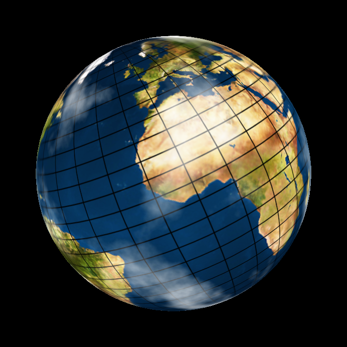
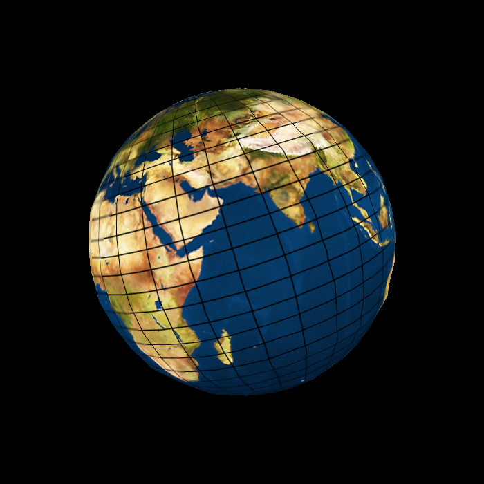

# Terra Textures

My first OpenGL program, written in 2009: a rotating Earth with up to six textures layered on it at once, using multitexturing. I wrote it for the *Elementi di grafica digitale* (elements of digital graphics) exam at the University of Trieste. In 2026 I restored it with Claude Code so that it builds and runs properly on Windows 10.



The layers are the Earth, a latitude/longitude grid, red highlights on Europe, America and Oceania, and clouds that drift on their own.

| Key | Layer |
| --- | --- |
| Space | stop or restart the rotation (the clouds keep moving) |
| 1 | the Earth |
| 2 | the grid |
| 3 | red highlight on Europe |
| 4 | red highlight on America |
| 5 | red highlight on Oceania |
| 6 | the clouds |
| Esc, Q | quit |

## How it works

`glutSolidSphere` has no texture coordinates, so the sphere is built by hand: rings of triangle strips from pole to pole, with each vertex's texture coordinates taken from its longitude and latitude. The textures are equirectangular world maps, so they wrap onto the sphere directly.

Plain `glTexCoord` and `glBindTexture` handle one texture at a time. With multitexturing (the `GL_ARB_multitexture` extension, then part of OpenGL 1.3) each layer gets its own texture unit: `glActiveTexture` selects the unit and `glMultiTexCoord2f` gives each unit its coordinates. Each unit multiplies the colour by its texture. White parts of a layer leave the Earth unchanged, the grid's black lines darken it, and red areas tint the continents.

The clouds are drawn in a second pass with blending, `earth × (1 − cloud) + cloud`, so thick clouds come out white.

On Windows, `opengl32.dll` only exports OpenGL 1.1, so the program looks up the multitexture functions at run time with `wglGetProcAddress`.

The source, [`TerraTextures/sfera.cpp`](TerraTextures/sfera.cpp), explains all this in its comments.

## Building it

You need CMake and a C++ compiler; on Windows, Visual Studio 2019 or later. CMake downloads [freeglut](https://github.com/freeglut/freeglut) (the maintained version of GLUT) and builds it into the program.

```bash
cmake -S . -B build
cmake --build build --config Release
```

Then run `build/Release/TerraTextures.exe` (on Linux, `build/TerraTextures`). The build copies the textures next to the program. Visual Studio can also open the folder directly as a CMake project.

`TerraTextures --capture out.ppm [layers]` renders two seconds of animation, saves the last frame and exits, without user input. `layers` is a string of digits, for example `1236`.

## What the 2026 restoration changed

The first commit is the project as I submitted it in May 2009, except for `glext.h`: that was a 2000 SGI header whose licence doesn't allow redistribution. Built today with a stand-in for that header, the 2009 code runs, but looks like this:



What was wrong, and what changed:

- Only four layers worked. OpenGL drivers give the fixed-function pipeline a limited number of texture units: 4 on current NVIDIA cards. The 2009 code assumed 6, so the Oceania highlight and the clouds never appeared. It now reads `GL_MAX_TEXTURE_UNITS` and draws the layers that don't fit in another pass, multiplied in with blending.
- The texture environment was set per texture, when it belongs to the texture unit. Each texture was given a mode as it was loaded (`GL_MODULATE`, `GL_DECAL`, `GL_REPLACE`), but all those calls went to unit 0, so the last one won. Unit 0 ended up in `GL_REPLACE` and the others in the default `GL_MODULATE`. The masks only looked right by accident, and the clouds' `GL_REPLACE` would have hidden the Earth if it had worked. Each unit now gets its mode when it's bound.
- Hiding a layer didn't turn it off. Keys 1–6 stopped sending the layer's texture coordinates, so the unit stayed on and kept sampling one texel. Now the unit is disabled.
- The second hemisphere read past the end of the vertex array (`VERTICI[Nvertici]`) and started with a stray vertex. The sphere was two mirrored hemispheres that relied on negative texture coordinates wrapping around. It's now one sphere, pole to pole.
- Vertex positions were stored as `int`, which rounded the sphere's points and made its outline bumpy. They're floats now, on a finer 5° mesh.
- The Earth didn't spin around its own axis. The axis was tilted, then the whole globe rotated around the screen's vertical, so it wobbled. Now it's tilted 23.4° and spins around that axis.
- The speed depended on the frame rate. The angle went up by 0.3° per frame, and drawing was called directly from the idle callback, so the faster the card, the faster the Earth spun. The animation is now time-based, and the idle callback asks GLUT to redraw.
- Windows-only code: `UINT` instead of `GLuint`, and `wglGetProcAddress` without a guard. That's why it didn't build on my professor's Mac. It now builds with freeglut on Windows, Linux and macOS (only Windows tested).
- A missing texture file crashed it. Now it prints which file it couldn't open.
- Comments and messages are now in English. The Visual Studio 2008 project is replaced by CMake.

The textures are the ones from 2009. Where the Earth map came from isn't recorded.

## License

The code is under the [MIT License](LICENSE). `image.cpp` and `image.h`, the BMP loader, come from the videotutorialsrock.com OpenGL tutorial and are also under the MIT licence (see their headers). The licence doesn't cover the Earth map (see above).
